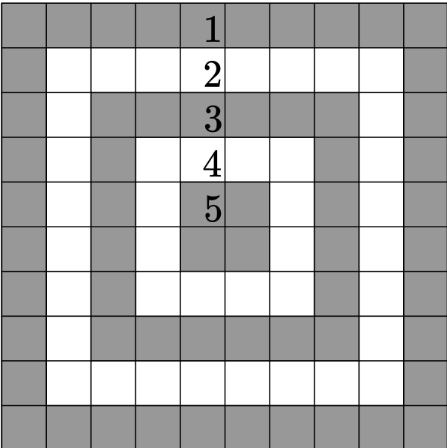

# C. Target Practice

Problem source: https://codeforces.com/problemset/problem/1873/C

Time limit per test: 1 second  
Memory limit per test: 256 megabytes

## Problem

You are given a `10 × 10` target divided into five concentric rings. The
outermost ring is worth 1 point, the next ring is worth 2 points, and the
center ring is worth 5 points.

Each cell contains either `X`, representing an arrow, or `.`, representing an
empty cell. Calculate the total score of all arrows.



## Input

The first line contains an integer `t` (`1 ≤ t ≤ 1000`) — the number of test
cases.

Each test case consists of 10 lines, each containing 10 characters. Every
character is either `X` or `.`.

## Output

For each test case, print the total score of all arrows.

## Examples

### Test Case 1

Input:

```text
X.........
..........
.......X..
.....X....
......X...
..........
.........X
..X.......
..........
.........X
```

Output:

```text
17
```

### Test Case 2

Input:

```text
..........
..........
..........
..........
..........
..........
..........
..........
..........
..........
```

Output:

```text
0
```

### Test Case 3

Input:

```text
..........
..........
..........
..........
....X.....
..........
..........
..........
..........
..........
```

Output:

```text
5
```

### Test Case 4

Input:

```text
XXXXXXXXXX
XXXXXXXXXX
XXXXXXXXXX
XXXXXXXXXX
XXXXXXXXXX
XXXXXXXXXX
XXXXXXXXXX
XXXXXXXXXX
XXXXXXXXXX
XXXXXXXXXX
```

Output:

```text
220
```

## Approach

For every cell containing `X`, determine its ring from its minimum distance to
the four edges:

`ring = min(row, column, 9 - row, 9 - column)`

Using zero-based indices, the score of the cell is `ring + 1`. Add the score
of every arrow to obtain the answer.

## Complexity

Each test case examines all 100 cells, taking `O(1)` time and `O(1)` extra
space.

## Files in this folder

- [CTargetPractice.java](CTargetPractice.java)
- [Question.txt](Question.txt)
